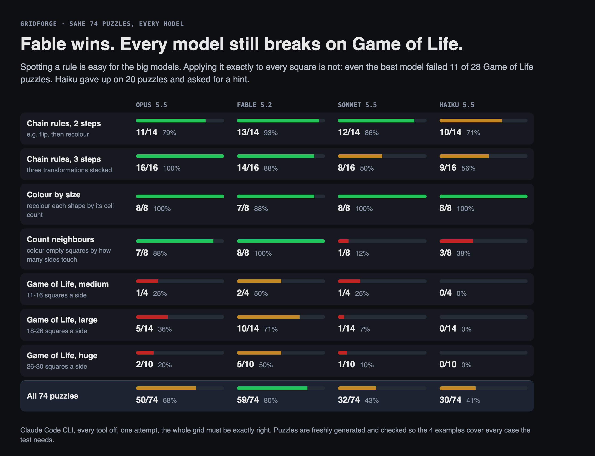
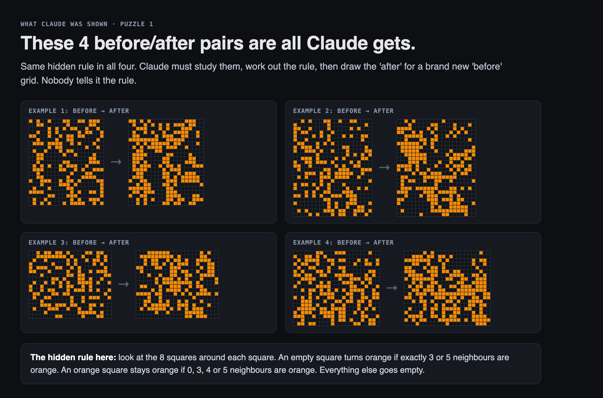
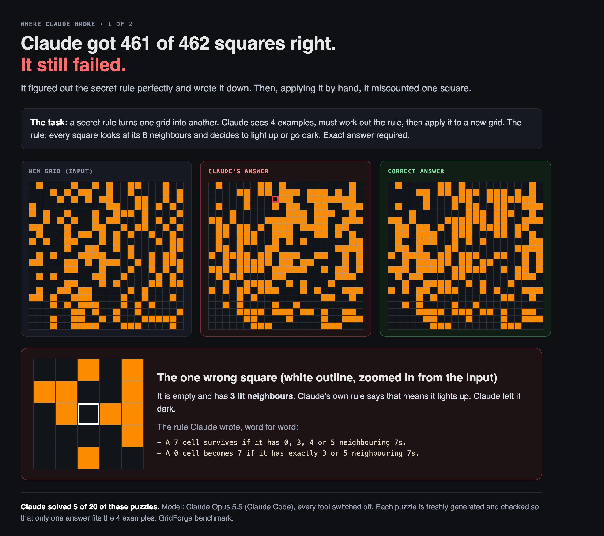
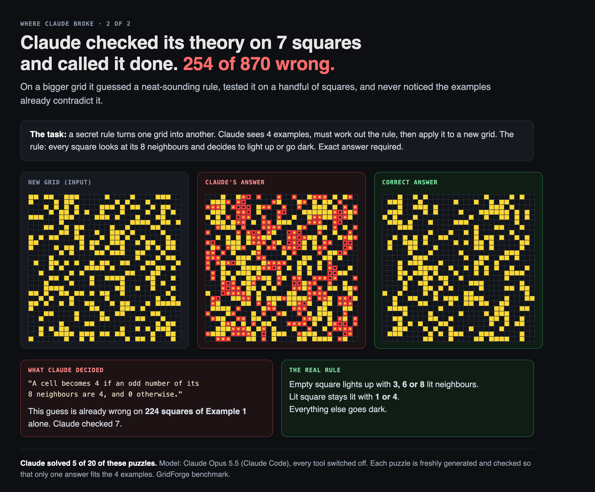

# Stickler

**A puzzle test that shows where AI models break.** (Formerly GridForge.)

**Website:** [mayankvashishtt.github.io/stickler](https://mayankvashishtt.github.io/stickler/): leaderboard, how it works, and a game where you spot the AI's mistakes.

```bash
pip install git+https://github.com/mayankvashishtt/stickler   # then: stickler bench --model <name>
```

Stickler makes picture puzzles out of coloured grids. Every puzzle is brand new (made by code
from a number called a *seed*), so no model can have seen it before. The code knows the right answer
and checks the model's answer automatically.



---

## The puzzle, in one minute

1. There is a **secret rule** that changes a grid. For example: *"an empty square turns orange if
   exactly 3 of the 8 squares around it are orange."*
2. The model sees **4 examples**. Each example is a grid **before** the rule and the same grid
   **after** the rule.
3. Nobody tells the model the rule. It has to work it out by comparing the before and after pictures.
4. Then it gets a **new "before" grid** and has to draw the "after" grid itself.
5. **Every square must be right.** One wrong square out of 900 counts as a fail, like in the
   ARC-AGI test.



### Is it fair?

Yes. A puzzle is only kept if:

- the examples show **every case** the test needs (if the test has "an empty square with 5
  neighbours", the examples have one too), and
- **no other simple rule** fits the examples but gives a different answer.

So when a model fails, it is the model's mistake, not a trick question.

---

## The puzzle types

| Type | What the secret rule does | Hard because |
| --- | --- | --- |
| **Chain rules** | 2 or 3 steps stacked, like *flip, then make things fall down, then recolour*. Picked from 24 building blocks. | many rules to try |
| **Colour by size** | every shape gets a colour based on how many squares it has | counting shapes |
| **Count neighbours** | every empty square gets a colour based on how many filled squares touch its sides | counting every square |
| **Game of Life** | every square looks at its 8 neighbours and turns on or off, using made-up numbers | counting every square, 400 to 900 times, exactly |

Grid sizes: medium (11 to 16 squares a side), large (18 to 26), huge (26 to 30).

---

## Results

Same 74 puzzles for every model. Claude Code CLI with **every tool switched off** (no code, no
calculator, no internet). One try per puzzle.

| Puzzle type | Opus 5.5 | Fable 5.2 | Sonnet 5.5 | Haiku 5.5 |
| --- | --- | --- | --- | --- |
| Chain rules, 2 steps | 11/14 | 13/14 | 12/14 | 10/14 |
| Chain rules, 3 steps | 16/16 | 14/16 | 8/16 | 9/16 |
| Colour by size | 8/8 | 7/8 | 8/8 | 8/8 |
| Count neighbours | 7/8 | 8/8 | 1/8 | 3/8 |
| Game of Life, medium | 1/4 | 2/4 | 1/4 | 0/4 |
| Game of Life, large | 5/14 | 10/14 | 1/14 | 0/14 |
| Game of Life, huge | 2/10 | 5/10 | 1/10 | 0/10 |
| **Total** | **50/74 (68%)** | **59/74 (80%)** | **32/74 (43%)** | **30/74 (41%)** |

### What we learned

- **Spotting a rule is easy for big models.** Opus solved every 3-step chain puzzle.
- **Applying a rule exactly is hard for all of them.** Even the best model, Fable, failed 11 of 28
  Game of Life puzzles. Bigger grids mean more failures.
- **Small models fall apart on counting.** Haiku solved 0 Game of Life puzzles. On 20 puzzles it
  did not answer at all and asked for a hint instead.

Two puzzles turned out to have a second rule that also fit the examples, so they were removed for
every model (`d2l/17`, `d2m/13`). That is why the total is 74, not 76.

### Two real failures

**Right rule, one slip.** Opus wrote the rule down correctly, then got 461 of 462 squares right.
One square was miscounted, so the whole answer fails.



**Wrong rule, never checked.** Opus guessed a neat rule ("odd number of neighbours"), checked it on
7 squares and stopped. The examples already disagreed with it on 224 squares. 254 squares wrong.



More failure screenshots are in [`proof/`](proof). Every model's full answers are in
[`results/`](results) (one line per puzzle, with the prompt, the reply and the right answer).
`results/claude-pilot` is an early run made before the fairness checks were tightened, so it is not
part of the comparison.

## Harder levels

Three extra tests on top of the 74, same models, still no tools (`--suite steps|trap|fix`).

| Level | What changes | Fable 5.2 | Opus 5.5 | Sonnet 5.5 | Haiku 5.5 |
| --- | --- | --- | --- | --- | --- |
| **Many steps** | apply the rule 3 times in a row | 10/12 | 6/12 | 1/12 | 0/12 |
| **Trap** | the rule is one number off the famous Game of Life | 6/12 | 6/12 | 3/12 | 2/12 |
| **Fix the slip** | given a real near-miss answer and told how many squares are wrong | 21/22 | 19/22 | 14/22 | 8/22 |

**Trap is the interesting one.** The examples clearly show the rule is *not* Conway's Game of Life
(each one shows the difference at least 4 times). Still, on 5 of Fable's 6 fails and 5 of Opus's 6,
the model said "this is Conway's Game of Life" and applied the famous rule almost perfectly. It
recognised a pattern it had memorised and stopped reading the evidence.

**Fixing is easy, finding is hard.** Told *exactly* how many squares are wrong, Fable fixes 21 of 22
near misses. Without that hint, the same slips go unnoticed.

**Tried and dropped: Marathon.** 8 steps on 30x30 grids made every model fail, but mostly because the
answer ran past API limits (one Fable run thought for ~311,000 tokens and was stopped by the API), not
because of a wrong grid. That is not a fair result, so it is not on the table; the raw runs are in
`results/void-marathon8/`. 6 steps on 18-26 grids was solved by Fable 3 of 3 in a pilot.

---

## Test your own model

Any model behind an OpenAI-style API works: OpenAI, Gemini, DeepSeek, OpenRouter, or a local model with
Ollama or vLLM. It gets the **same 74 puzzles** as the table above, with no tools and one try each.

```bash
git clone https://github.com/mayankvashishtt/stickler.git && cd stickler

export OPENAI_API_KEY=...                       # your own key
python3 -m stickler bench --model gpt-5-mini --workers 8
```

Other providers only need a different address:

| Provider | `OPENAI_BASE_URL` |
| --- | --- |
| OpenAI | (leave unset) |
| Gemini | `https://generativelanguage.googleapis.com/v1beta/openai` |
| DeepSeek | `https://api.deepseek.com/v1` |
| OpenRouter (most models) | `https://openrouter.ai/api/v1` |
| Ollama on your laptop | `http://localhost:11434/v1` (no key needed) |

For reasoning models, `STICKLER_EFFORT=high` sets the reasoning effort. Results go to
`results/<model>/results.jsonl`, with every prompt, answer and token count.

**Using your own harness instead?** Take the puzzles as one file and score your answers:

```bash
python3 -m stickler export                       # data/stickler-74.jsonl: id, prompt, answer
python3 -m stickler score my_predictions.jsonl   # one JSON per line: {"id", "reply"} or {"id", "grid"}
```

**Get on the leaderboard:** open a pull request that adds your `results/<model>/` folder. Say which
model, which settings and the date.

---

## How to run it

You need **Python 3.9 or newer**. The puzzle code has no other requirements.

```bash
git clone https://github.com/mayankvashishtt/stickler.git
cd stickler

# see one puzzle and its secret rule
python3 -m stickler show --seed 3 --depth 2 --size m --rule

# check the puzzles are solvable: a perfect solver must get 100%, copying the input must get 0%
python3 -m stickler validate --seeds 0-19
python3 -m stickler validate --families life,count,sizecolor --seeds 0-9 --sizes m,l
```

### Test a Claude model

This uses the [Claude Code](https://claude.com/claude-code) CLI (`claude`) with every tool turned off.

```bash
# Game of Life puzzles, large and huge grids, 8 at a time
python3 -m stickler run --agent claude --families life --seeds 4-13 --sizes l,xl --workers 8 --out results/my-run

# pick a model
python3 -m stickler run --agent claude --model sonnet --families life --seeds 4-13 --sizes l,xl --out results/sonnet-run
```

To repeat the full comparison above:

```bash
scripts/compare.sh claude-opus-5-5 claude     # also: sonnet sonnet, haiku haiku, claude-fable-5-2 fable
python3 scripts/compare_report.py             # writes results/COMPARE.md and proof/compare_models.png
```

### Options

| Option | Meaning | Default |
| --- | --- | --- |
| `--families` | `chain`, `life`, `count`, `sizecolor` (comma separated) | `chain` |
| `--seeds` | which puzzles, e.g. `0-9` or `1,5,7` | `0-9` |
| `--depths` | number of steps for chain rules | `1,2,3` |
| `--sizes` | `s`, `m`, `l`, `xl` | `s,m,l` |
| `--train` | how many examples the model sees | `4` |
| `--turns` | tries per puzzle (feedback after each wrong try) | `1` |
| `--workers` | puzzles run at the same time | `4` |

### Make screenshots of failures

Needs Google Chrome and Pillow (`pip install pillow`).

```bash
python3 scripts/cards.py results/my-run/results.jsonl proof/
```

---

## Use it to train a model (RL environment)

Stickler also works as a training environment, not just a test.

```python
from stickler.gen import generate
from stickler.episode import GridEnv

env = GridEnv(generate(seed=1, depth=2, size="m"), max_turns=3)
prompt = env.reset()
prompt, reward, done, info = env.step(model_reply)
```

- **Reward 1.0** for a perfect grid.
- Otherwise **0.5 x the share of correct squares** (0 if the grid is the wrong size), so being
  close still earns something.
- After a wrong try the model is told **how many** squares are wrong, never **which** ones.

Because puzzles come from seeds, you can make as many fresh ones as you want and the model can
never memorise them.

---

## Folder guide

| Path | What is inside |
| --- | --- |
| `stickler/grid.py` | grid basics: shapes, reading and printing grids |
| `stickler/prims.py` | the 24 building blocks for chain rules |
| `stickler/gen.py` | makes chain puzzles and runs the fairness check |
| `stickler/hard.py` | Game of Life, count neighbours and colour by size puzzles |
| `stickler/episode.py` | the prompt, answer reading, scoring and the RL environment |
| `stickler/agents.py` | the solvers: perfect solver, copy baseline, Claude CLI, any OpenAI-style API |
| `stickler/runner.py` | runs many puzzles and writes the results |
| `scripts/` | screenshots, comparison table, comparison runs |
| `results/` | every run, every answer |
| `data/stickler-74.jsonl` | the 74 leaderboard puzzles with answers, for other harnesses |
| `web/` | the website and games (`scripts/export_web.py`, `scripts/export_daily.py` make its data) |
| `proof/`, `slack-post/` | images |
